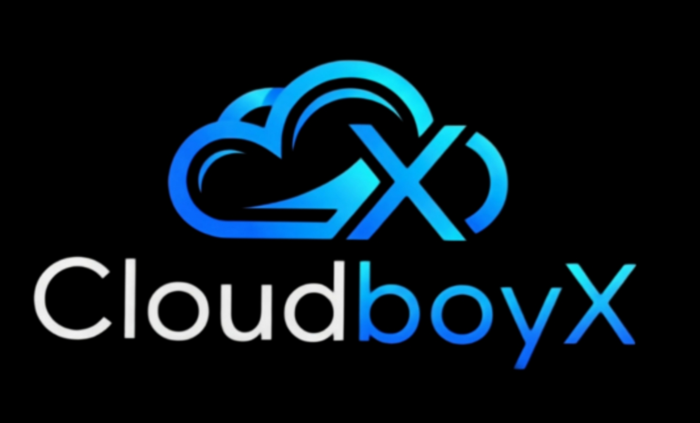

# CloudboyX Enterprise Platform



**CloudboyX** is an autonomous enterprise orchestration platform integrating multi-channel commerce translation, immutable GAAP double-entry ledger bookkeeping, real-time MAP (Minimum Advertised Price) brand defense, Bayesian quantitative prediction, and visual website publishing.

---

## 📑 Documentation & User Guides

- **Markdown User & Operations Manual**: [`HOWTO_MANUAL.md`](HOWTO_MANUAL.md) — Comprehensive step-by-step how-to instructions for all 10 platform modules.
- **Official Enterprise PDF Guide**: Download [`CloudboyX_Enterprise_Platform_Guide.pdf`](public/CloudboyX_Enterprise_Platform_Guide.pdf) directly or access it from the root directory.

---

## 🏛️ Comprehensive Architecture & Module Breakdown

The platform is partitioned into **10 specialized, interconnected operational modules**:

```
                              ┌──────────────────────────────────────────────────┐
                              │            Central Access Menu Hub               │
                              │        (Executive Dashboard & Router)            │
                              └────────────────────────┬─────────────────────────┘
                                                       │
         ┌─────────────────────┬───────────────────────┼───────────────────────┬─────────────────────┐
         ▼                     ▼                       ▼                       ▼                     ▼
┌──────────────────┐  ┌──────────────────┐  ┌──────────────────┐  ┌──────────────────┐  ┌──────────────────┐
│  01. ERP Ledger  │  │ 02. Ingress & QR │  │ 03. MAP Defense  │  │   04. Predict    │  │ 05. Design Studio│
│  (Double-Entry)  │  │ (Multi-Feed OCR) │  │  (Reseller C&D)  │  │ (Bayesian Debate)│  │ (Bootstrap 5)    │
└──────────────────┘  └──────────────────┘  └──────────────────┘  └──────────────────┘  └──────────────────┘
         │                     │                       │                       │                     │
         ▼                     ▼                       ▼                       ▼                     ▼
┌──────────────────┐  ┌──────────────────┐  ┌──────────────────┐  ┌──────────────────┐  ┌──────────────────┐
│ 06. Procurement  │  │ 07. Multi-Entity │  │ 08. SQL Console  │  │ 09. RBAC & Test  │  │ 10. Marketing    │
│ (PO Lifecycle)   │  │ (GAAP Rollup)    │  │ (Relational DB)  │  │ (Sandbox Mode)   │  │ (Public Showcase)│
└──────────────────┘  └──────────────────┘  └──────────────────┘  └──────────────────┘  └──────────────────┘
```

---

### Module 01: Financial Ledger & GAAP Double-Entry Engine
- **Primary Source**: `src/ledgerEngine.ts`, `src/App.tsx` (Ledger section)
- **Database Engine**: In-memory relational SQL (`alasql`) simulating balanced accounting ledgers.
- **Core Functionality**:
  - Automatically posts balanced double-entry transactions (`Total Debits === Total Credits`) for every ingested order.
  - Dynamically calculates real-time balances for Assets (1000s), Liabilities (2000s), Equity (3000s), Revenue (4000s), and Expenses (5000s).
  - Reversible transaction mechanics with automated offsetting reversing entries.
  - Export capabilities: Vector PDF, raw CSV table, and QuickBooks `.IIF` interchange files.

### Module 02: Universal Ingress Gateway & Optical QR / Barcode Scanner
- **Primary Source**: `src/gateway.ts`, `src/canonical.ts`, `src/App.tsx` (Scanner & Feed tabs)
- **Core Functionality**:
  - Ingests feeds from Shopify JSON, EDI ANSI X12 850 documents, legacy CSV feeds, AI document mapping, and physical optical scans.
  - Standardizes raw structures into the immutable `CanonicalOrder` specification with integer cent-precision line items.
  - **Camera Scanner**: WebRTC camera viewfinder with real-time torch/flashlight controls, hardware zoom slider, and Canvas-based thermal/grayscale image enhancement filters.
  - **Scan History**: Local storage persistence with favorite pattern pinning (`★`) and a 3-way sort dropdown (Date: Newest First, Date: Oldest First, and Favorites First).

### Module 03: Autonomous MAP & Brand Defense Intelligence Suite
- **Primary Source**: `src/components/MapProtectionModule.tsx`, `src/server/mapProtectionRoutes.ts`
- **Core Functionality**:
  - Continuous 24/7 monitoring of Minimum Advertised Price (MAP) thresholds across Amazon, Walmart, eBay, Target, and rogue storefronts.
  - Computes exact margin leakage, market risk scores, and price deviation percentages.
  - Automated 3-Tier Cease & Desist (C&D) legal enforcement dispatch pipeline.
  - Marketplace crawler simulator to test distributor compliance triggers in real time.

### Module 04: CloudboyX Predict & Bayesian Odds Analytics Engine
- **Primary Source**: `src/predict/PredictModule.tsx`, `src/server/predictRoutes.ts`
- **Core Functionality**:
  - Dual-agent AI debate matrix (Bull Agent vs. Bear Agent) synthesizing real-world market probabilities.
  - Expected Value (+EV) calculation engine with interactive probability and odds sliders.
  - Fractional Kelly Criterion bankroll sizing algorithms to calculate mathematically optimal risk allocations.
  - Contract ledger tracking historical predictions, realized yields, and settlement confirmations.

### Module 05: CloudboyX Design Studio (Bootstrap 5 Site Builder)
- **Primary Source**: `src/design/`, `src/design/App.tsx`, `src/design/CloudboyXDesignStudio.tsx`
- **Core Functionality**:
  - Visual drag-and-drop website creation environment built on standard Bootstrap 5.3 semantics.
  - 108+ pre-built industry templates for SaaS, E-Commerce, Portfolios, Consulting, and Enterprise Landing Pages.
  - Fluid 100% full-screen canvas on Desktop, with simulated Tablet (768px) and Mobile (390px) responsive device frames.
  - AI Semantic Block Search via Command Palette (`Ctrl+K` / `⌘K`) backed by `/api/ai/search-blocks`.
  - Dynamic Google Fonts picker with live specimen rendering.
  - Agency white-label branding, client review portal, client invoicing, and zero-lock-in HTML5 export.

### Module 06: Procurement Portal & Global Supply Chain Management
- **Primary Source**: `src/components/ProcurementPortal.tsx`
- **Core Functionality**:
  - Purchase order lifecycle tracking: `Draft` ➔ `Submitted` ➔ `Approved` ➔ `Received`.
  - Vendor catalog cross-referencing with multi-currency conversion (USD, EUR, GBP, CAD).
  - Automatic inventory receipt posting directly into Accounts Payable in the General Ledger.

### Module 07: Multi-Entity GAAP Accounting & Intercompany Consolidation
- **Primary Source**: `src/components/MultiEntityOverview.tsx`
- **Core Functionality**:
  - Supports international corporate parent/subsidiary structures (US Domestic, EU Logistics BV, UK Trading Ltd).
  - Automated intercompany elimination engine to cancel out offsetting intercompany loans and management fees.
  - Entity-specific filtering and consolidated balance sheet rollups.

### Module 08: Diagnostics, SQL Console Workbench & Audit Trail
- **Primary Source**: `src/components/SQLConsoleWorkbench.tsx`, `src/components/DiagnosticsPanel.tsx`
- **Core Functionality**:
  - Interactive SQL console allowing direct query execution (`SELECT * FROM accounts`, etc.) over in-memory relational tables.
  - Pre-built GAAP diagnostic queries (Equality Verification, Unbalanced Transactions, Balance Sheet Proof).
  - Real-time immutable security and relational audit trail timeline.

### Module 09: User Authentication, RBAC & Test Sandbox vs. Live Production
- **Primary Source**: `src/components/AuthModal.tsx`, `src/context/AuthContext.tsx`, `src/data/expandedSeedData.ts`
- **Core Functionality**:
  - Firebase Authentication supporting Google Sign-In and Email/Password credentials.
  - Role-Based Access Control (RBAC): Owner, Admin, Editor, Client Reviewer.
  - **Environment Mode Switcher**: Seamless toggle between `🧪 Test Sandbox` (pre-seeded with rich test orders, vendors, and transactions that persist upon GitHub export) and `🟢 Live Production`.
  - Reseller co-branding locking to protect licensing and regulatory notices.

### Module 10: Central Access Menu Hub & Public Marketing Website
- **Primary Source**: `src/components/ModuleAccessHub.tsx`, `src/components/MarketingLandingPage.tsx`
- **Core Functionality**:
  - Executive launchpad organizing all platform modules into actionable operational cards with permission status badges.
  - Standalone consumer-facing marketing showcase with live interactive demo previews.

---

## 🚀 Quick Start Guide

### Prerequisites
- **Node.js**: v18.0.0 or higher (v20+ recommended)
- **npm** (included with Node.js) or **pnpm** / **yarn** / **bun**

### 1. Installation
```bash
git clone https://github.com/Coder-Wandering/CloudboyX-Design.git
cd CloudboyX-Design
npm install
```

### 2. Environment Variables (Optional)
Copy `.env.example` to `.env`:
```bash
cp .env.example .env
```
```env
PORT=3000
# Optional: Enables AI natural language block recommendations in Design Studio
GEMINI_API_KEY=your_gemini_api_key_here
```
> **Self-Contained Assurance**: All core functionality (ERP Ledger, QR Camera Scanner, MAP Protection, Predict Engine, and Bootstrap Builder) runs 100% locally in-memory without requiring external cloud accounts or paid APIs!

### 3. Start Development Server
```bash
npm run dev
```
Open [http://localhost:3000](http://localhost:3000) in your web browser.

### 4. Running Unit Tests
```bash
npm test
```
Executes all 24 Vitest unit tests verifying double-entry mathematical integrity, balance sheet balancing, and Universal Gateway translation.

### 5. Production Build & Deployment
```bash
npm run build
npm start
```

---

## 🛠️ API & Endpoint Reference

| Method | Endpoint | Description |
|---|---|---|
| `POST` | `/api/ai/search-blocks` | AI semantic natural language block search for Design Studio (`gemini-2.5-flash`). |
| `POST` | `/api/ledger/post` | Posts balanced double-entry transaction to in-memory relational ledger. |
| `POST` | `/api/ledger/query` | Executes direct SQL query against accounts and journal entries. |
| `POST` | `/api/ledger/reset` | Resets ledger to baseline seed balances. |
| `POST` | `/api/map/audit` | Scrapes reseller prices and computes MAP compliance violations. |
| `POST` | `/api/predict/debate` | Triggers dual-agent Bull/Bear Bayesian debate on event contracts. |
| `POST` | `/api/procurement` | Creates and updates line-item purchase orders. |
| `POST` | `/api/ai-map` | Semantic schema field mapping for unstructured order data. |

---

## 📄 License & Compliance

Licensed under the Apache-2.0 License. Designed for GAAP/IFRS regulatory compliance and autonomous enterprise operations.
